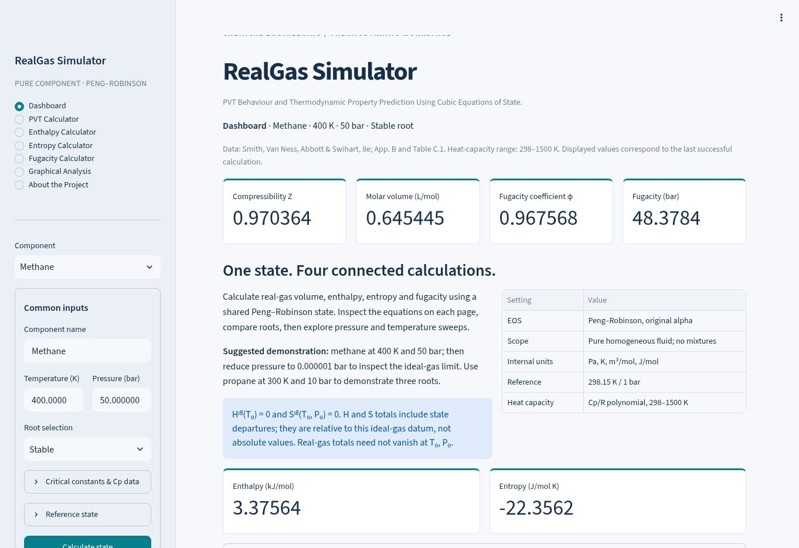
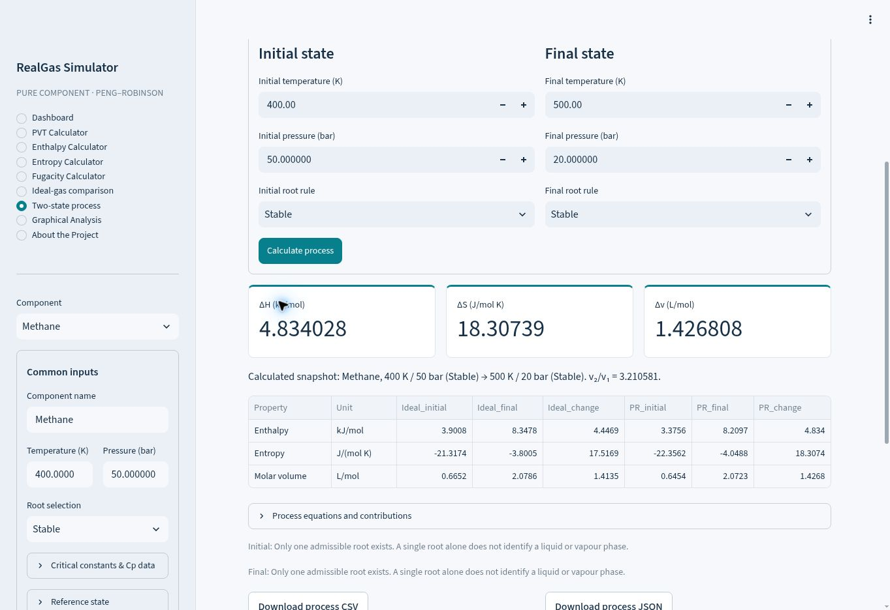

# RealGas Simulator

[](https://github.com/soorprem/RealGas-Simulator/actions/workflows/tests.yml)

**PVT behaviour and thermodynamic property prediction using cubic equations of state.**

An undergraduate Chemical Engineering project by **Prem Soor, IIT Delhi**. Calculate
pure-component compressibility, molar volume, enthalpy, entropy and fugacity with
the Peng–Robinson equation of state. Inspect every equation and intermediate result,
compare ideal and real gases, and calculate property changes between two states.

[Four-page report](report.pdf) · [Theory and derivation](THEORY.md) ·
[Validation results](validation/summary.csv) · [Flowchart](flowchart.svg) ·
[Submission guide](SUBMISSION_GUIDE.md)

*Earlier interface screenshot; open the public website above to view the redesigned dashboard.*



### Two-state process calculation



### At a glance

| Capability | Implementation |
|---|---|
| Equation of state | Pure-component Peng–Robinson with temperature-dependent attraction |
| Properties | Z, molar volume, ideal/residual/total H and S, fugacity coefficient and fugacity |
| Process analysis | Two-state changes with one component and a common reference state |
| Components | Methane, nitrogen, carbon dioxide, propane, ethane and manual inputs |
| Exploration | Ten interactive plots, root selection and ideal-gas comparisons |
| Reproducibility | Modular Python source, sample data, tests and independent PR checks |

**Verification:** the supplied records contain 41 passing tests, 80 independent
scalar PR checks and a 350-state pressure reconstruction grid. The badge above
shows the separate GitHub Actions status. These checks verify implementation;
they do not establish experimental accuracy. See the limitations below.

**Start here:** install the dependencies and run `streamlit run app.py` using the
steps below. Use the public website link below to evaluate the app immediately, or download
the easy-start ZIP to run the source locally.

Complete Python/Streamlit project built from scratch with the pure-component Peng–Robinson EOS.

## Open the public website

**[Launch RealGas Simulator](https://realgas-simulator-pr-2026.serenepier2.chatgpt.site/)**

Publicly accessible for evaluation and sharing; no local Python installation is
needed. The first visit loads browser Python and scientific packages and can take
up to two minutes. Keep an Internet connection during initial loading.

## Download the easy-start project

**[Download RealGas_Ready_To_Run.zip](downloads/RealGas_Ready_To_Run.zip)**

Extract the whole ZIP into a **new folder**, then open `RealGas_Simple`:

- **Use the hosted app:** open `OPEN_WEBSITE.html`, then click Open RealGas Simulator.
- **Windows local app:** install Python 3.12 (recommended), then double-click
  `START_WINDOWS.bat`. The launcher prepares an isolated environment and installs
  dependencies on first use. Internet is required for this setup.
- **Mac/Linux local app:** run `sh START_MAC_LINUX.command` from that folder.
- Read `START_HERE.txt` for manual commands and troubleshooting.

If local setup fails, the Windows terminal stays open and `setup_log.txt` records
its error. Share that error when requesting help. Python 3.11/3.12 are the tested
versions; the launcher also attempts newer Python installations. The batch file
has not been executed on a Windows test machine.

The redesigned dashboard retains all nine sections, ten analysis plots,
calculation details, history and exports. Source modules below match the
redesigned interface. The four-page report retains its earlier interface
screenshots; its equations and numerical results still apply.

## Run the website manually

Install Python 3.11 or 3.12. Open a terminal in the cloned repository root, or in
`RealGas_Simple` after extracting the easy-start ZIP.

```bash
python -m venv .venv
```

Activate the environment:

- Windows PowerShell: `.venv\Scripts\Activate.ps1`
- Windows Command Prompt: `.venv\Scripts\activate.bat`
- macOS/Linux: `source .venv/bin/activate`

Then install and launch:

```bash
python -m pip install -r requirements.txt
streamlit run app.py
```

Open the local URL printed by Streamlit (normally http://localhost:8501).
If the command is not found, use `python -m streamlit run app.py`.
Keep the terminal running during the demonstration. Stop with Ctrl+C.
After installation, the local application does not need Internet access.
Do not double-click app.py: it must be launched with Streamlit.

## What is included

- Nine sidebar sections: Dashboard, PVT, Enthalpy, Entropy, Fugacity, Ideal-gas comparison, Two-state process, Graphical Analysis, About.
- Five textbook presets: methane, nitrogen, carbon dioxide, propane, ethane.
- Editable critical constants, Cp coefficients, component name and reference state; custom components.
- Cubic roots with mechanical-stability checks and stable/vapour/liquid selection.
- Ideal, residual and total enthalpy/entropy, analytical alpha derivative and fugacity.
- Equations, substitutions, intermediate variables, units and derivation.
- Ten interactive plots with editable bounds, session history, CSV/JSON/PDF downloads.
- Four-page `report.pdf`, editable report-generation script, flowchart PNG/SVG/Mermaid source.
- Actual browser screenshots in `screenshots/`, sample inputs and outputs, validation CSV files.

## Suggested demonstration

1. Start with methane, 400 K, 50 bar, stable root, reference 298.15 K and 1 bar.
2. Click **Calculate state**. Dashboard values should match `sample_output.csv`.
3. Open PVT to inspect roots and EOS parameters. Open enthalpy, entropy and fugacity pages.
4. Expand **Calculation details** for the full equations and numerical substitutions.
5. Set pressure to 0.000001 bar and calculate. Z and phi approach 1; departures approach zero.
6. Select propane, T=300 K and P=10 bar, then calculate. PVT displays three roots.
7. Try Stable/Vapour/Liquid and note possible metastability. For propane at 300 K, saturation is near 10 bar; equal outer fugacity is the criterion, not merely the existence of three roots.
8. Open Graphical Analysis and adjust ranges. Click **Generate graphs** and download sweep data.
9. Download the calculated-state CSV, complete JSON, calculation PDF and session history.

Changing an input does not update the result until **Calculate state** is pressed.
Component selection reloads the input form but retains the previous result until calculation.
Failed calculations retain the last valid snapshot with an error message.
History is session-only, not a persistent database.

## Sample output: methane at 400 K and 50 bar

| Quantity | Result |
|---|---:|
| Z | 0.9703643228 |
| Molar volume | 0.6454446310 L/mol |
| phi | 0.9675679670 |
| Fugacity | 48.37839835 bar |
| Ideal enthalpy | 3.900819045 kJ/mol |
| Residual enthalpy | -0.5251751244 kJ/mol |
| Total enthalpy | 3.375643920 kJ/mol |
| Ideal entropy | -21.31742928 J/(mol K) |
| Residual entropy | -1.038813251 J/(mol K) |
| Total entropy | -22.35624253 J/(mol K) |

**Reference convention:** H_ideal(T0)=0 and S_ideal(T0,P0)=0. Totals include the
state departure and need not be zero at the real reference state. They are not
formation enthalpies or third-law entropies. To obtain real-fluid changes, subtract
totals for two states on the same datum. A negative entropy relative to this datum
is not a negative absolute entropy.

## Architecture

| File | Responsibility |
|---|---|
| app.py | Streamlit UI, inputs, session history and downloads |
| ui.py | Redesigned presentation, dashboard and working navigation shortcuts |
| run.py | First-run environment setup, diagnostics and local launch |
| component_data.py | Textbook presets and component structure |
| eos_model.py | PR parameters, derivative, roots, stability and departures |
| ideal_gas.py | Cp validation and analytic H/S integrals |
| pvt_calculations.py | Shared state calculation and flat export |
| enthalpy.py, entropy.py, fugacity.py | Property assembly in stated units |
| calculation_details.py | Displayed equations, substitutions and derivation |
| plotting.py | Sweep datasets, ideal comparisons, P–V isotherms and Plotly figures |
| process_calculations.py | Two-state changes and ideal-gas comparison tables |
| extra_pages.py | Process and comparison interface sections |
| export_report.py | Calculation PDF from the displayed state |
| downloads.py | Native downloads / browser data links using the same bytes |
| validate.py | Executed independent-backend and grid validation tables |
| tests/ | Scientific and Streamlit interface tests |
| build_report.py | Four-page report and flowchart generation |
| build_browser.py | Same Python source bundled for Stlite browser runtime |

## Data, assumptions and limitations

Data: Smith, Van Ness, Abbott & Swihart, *Introduction to Chemical Engineering
Thermodynamics*, 8e, McGraw-Hill, 2018; Appendix B Table B.1 and Appendix C Table C.1.
Cp/R = A+B*T+C*T²+D/T²; the stored coefficients are unscaled.
Hydrocarbon Cp interval: 298–1500 K; nitrogen and CO2: 298–2000 K.
Total H and S require the entire reference-to-state interval within these bounds.
PVT, fugacity and departures remain available outside the Cp range.
Cp must remain positive; the code checks endpoints and all stationary points.

Unrounded PR critical-constraint constants follow NIST teqp canonical_PR:
https://pages.nist.gov/teqp-docs/en/main/models/cubics.html

The app uses original PR alpha for omega in [-0.5,0.5]. Numerical guards are
50–2500 K and 0.000001–2000 bar; these are NOT a guaranteed accuracy envelope.
PR is approximate, especially for liquid density and near-critical properties.
No mixtures, solids, reactions, association, transport properties or phase fractions.
Stable means minimum molar Gibbs energy among mechanically stable EOS roots.
A single root alone does not identify phase; forced outer roots can be metastable.
See `THEORY.md` for a complete derivation and the entropy reference conversion.

## Reproduce tests and validation

```bash
python -m pip install -r requirements-dev.txt
python -m pytest -q tests
python validate.py
python build_report.py
```

Executed result: **41 tests passed**. `validation/test_results.txt` and `tests.xml`
record the run. A 350-state grid checks pressure reconstruction. All 80 scalar
CoolProp PR comparisons passed using identical Tc/Pc/omega, including liquid states.
The public CoolProp residual entropy is at the same T and density; add R ln Z
before comparing it to our same-T,P departure. CoolProp is needed for validation,
not for ordinary app use. The four preset comparisons per gas are registered as
custom pure fluids; an unused mass placeholder satisfies the registration schema.
Only molar properties are compared.

Numerical tests additionally check departure identities, Cp quadrature, analytical
alpha derivatives, low-pressure limits and coexistence. These are implementation
verification, not experimental validation. `heos_model_comparison.csv` reports
separate comparisons with higher-accuracy CoolProp HEOS fluid models. At 400 K,
50 bar, the five gases show Z differences of approximately -0.63% to -2.97%.

## Browser-hosted build

The supplied `dist/` directory runs the same application with Stlite 1.11.0
(Python/WebAssembly), because static hosting does not run a Python Streamlit server.
Scientific calculations remain in the same `.py` files. Its Plotly wheel is 6.3.0;
the normal Python installation uses Plotly 7.1.0. Both render the same ten figures.
The first browser visit needs Internet access to load Stlite/Pyodide and packages.
Allow up to two minutes; local Streamlit is preferable for offline evaluation.

To regenerate `dist/` after source changes:

```bash
python build_browser.py
```

Serve `dist/` over HTTP, not by double-clicking index.html. The native Streamlit
installation remains the main submission program. Screenshots in this package
were captured from the browser build, not generated mockups.

## Report

`report.pdf` is exactly four A4 pages and reflects the implemented program and
executed results. The source is `build_report.py`; build it after `validate.py`.
The supplied textbook is a reference and is not redistributed with the software.

## New assignment extensions (8 November 2026)

- **Ideal-gas comparison:** the same T/P/reference with side-by-side v, Z, phi, f,
  H and S. Signed volume deviation is 100(Z-1)%; H/S percentages are omitted
  because their arbitrary datum makes percentages misleading.
- **Two-state process:** independent initial/final T, P and root rule. Displays
  ideal and PR endpoint values, delta H, delta S, delta v, volume ratio and
  residual corrections. CSV/JSON exports preserve both endpoint conditions.
  The same component data and ideal reference are used for both states.
  Heat/work or entropy generation require a process model and are not inferred.
- **Three added plots:** ideal/PR volume versus pressure, percent volume deviation
  versus pressure, and P–V isotherms at three editable temperatures. Raw unstable
  EOS segments are dotted. They are not equilibrium two-phase plateaus.
- New process examples: sample_process.csv / sample_process.json.
- Submission checklist and five-minute demonstration: SUBMISSION_GUIDE.md.
- To personalize the report, edit student_details.json and run build_report.py.
  The script checks that the result remains exactly four pages.

## Contributing and citation

See [CONTRIBUTING.md](CONTRIBUTING.md) before changing scientific calculations.
Use the repository's issue forms for calculation defects or feature proposals.
The [changelog](CHANGELOG.md) records delivered features and repository changes.

Citation metadata is provided in [CITATION.cff](CITATION.cff). When referring to
results, record the exact commit, component constants, inputs, units, root rule
and reference state so that the calculation can be reproduced.
